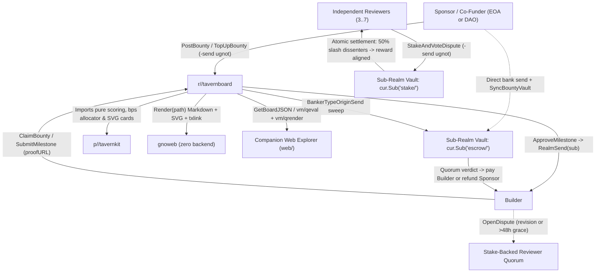

# TavernBoard

**On-chain micro-bounty escrow, stake-backed reviewer quorums, and composable builder reputation for Gno.land (v1.8 / Onyx & Mainnet).**

Built by **ReActRailGun** for the **Gnome Tavern Hackathon | Gno.land**.

---

## Why TavernBoard?

Most blockchain bounty boards pool every sponsor's funds into a single contract balance, rely on centralized off-chain frontends, ignore storage-rent cleanup, and trap builder reputation inside non-composable UIs.

**TavernBoard** is built from the ground up around **Gno.land v1.8 native primitives**:

| Capability | How TavernBoard Uses Gno.land v1.8 |
|---|---|
| **Isolated Per-Bounty Sub-Realm Vaults** | Every posted quest mints two dedicated sub-realm tokens via **`cur.Sub("escrow/<id>")`** and **`cur.Sub("stake/<id>")`**. Payouts execute through `banker.NewBanker(banker.BankerTypeRealmSend, sub)`, so the GnoVM banker itself guarantees Quest #1 can never spend a single `ugnot` belonging to Quest #2. |
| **Composable DAO & Cross-Realm Co-Funding** | Any user or external DAO realm can derive a quest's vault address off-chain or on-chain via **`chain.DerivePkgSubAddr`** (`DeriveEscrowAddress(id)`), transfer `ugnot` directly to that sub-address, and call **`SyncBountyVault`** to top up remaining unsettled milestones dust-free. |
| **Stake-Backed Reviewer Quorum & Slashing** | Contested milestones escalate to independent reviewers who stake `ugnot` into `stake/<id>`. Once strict majority quorum is reached, settlement executes atomically: the milestone pays out or refunds, dissenting reviewers forfeit 50% of their stake to aligned reviewers, and both vaults drain to `0 ugnot`. |
| **Pure Reusable Package (`p/.../tavernkit`)** | Stateless integer basis-point payout allocation, deterministic XP & Craft Tier scoring, quorum verdict math, and pure on-chain **SVG Guild Crest & Escrow Vault Card** rendering via `p/nt/svg/v0`. Any Gno realm can import `tavernkit` or gate membership with `tavernboard.HasCraftTier(addr, tier)`. |
| **Native `gnoweb` Application (`Render(path)`)** | Full multi-route Markdown + SVG app powered by `p/nt/mux/v0`, `p/nt/avl/pager/v0`, `p/nt/mdalert/v0`, `p/moul/mdtable/v0`, `p/moul/txlink/v0`, `p/nt/markdown/sanitize/v0`, and `r/sys/users` handle resolution. |
| **Storage-Deposit Hygiene** | Once a quest closes and its vaults hit `0 ugnot`, anyone can call **`ArchiveClosedBounty`** to prune heavy prose strings into a compact tombstone — reclaiming Gno.land storage deposits while keeping financial & reputation history intact. |

---

## Architecture



---

## Security & Interrealm v2 Compliance

Every line of `r/tavernboard` was audited against Gno's official [`gno-security-guide.md`](https://docs.gno.land/resources/gno-security-guide) and [`gno-ai-contract-review.md`](https://docs.gno.land/resources/gno-ai-contract-review):

- **Strict EOA Payment Guard**: `PostBounty`, `TopUpBounty`, and `StakeAndVoteDispute` verify `cur.IsCurrent()` AND `cur.Previous().IsUserCall()` (blocking `MsgRun` ephemeral realms and intermediate code realms from spoofing `OriginSend`), then sweep via `banker.NewBanker(banker.BankerTypeOriginSend, cur)`. Covered by regression test `TestSecurityPaymentGuardBlocksCodeRealmSpoofing`.
- **No `unsafe.PreviousRealm()`**: All caller identity is derived exclusively from `cur.Previous().Address()`.
- **Single-Denom Balance Reads**: All vault queries use `banker.NewReadonlyBanker().GetCoin(addr, "ugnot")` rather than `GetCoins(addr).AmountOf(...)`, preventing unsolicited-denom gas-griefing attacks.
- **No Leaked Mutable Pointers**: All stateful structs (`bounty`, `milestone`, `dispute`, `builderProfile`) are `/r/`-declared and unexported. Read APIs (`GetBounty`, `GetMilestones`, `GetProfile`, `GetStats`) return pure value copies.
- **Slot-Aware Markdown & URL Sanitization**: Every user-supplied title, summary, pitch, note, feedback, rationale, and URL is sanitized via `gno.land/p/nt/markdown/sanitize/v0` (`InlineText`, `Block`, `Blockquote`, `URL`, `HTMLEscape`) and unsafe `proofURL` schemes (`javascript:`, `data:text/html`) are rejected at write time.
- **Anti-Gaming Guards**: Sponsors cannot claim their own quests; sponsors and builders cannot vote as reviewers on their own disputes; duplicate reviewer votes abort; earnings XP bonus is capped so whales cannot buy Archmage rank without real deliveries.

---

## Project Layout

```text
.
├── gnowork.toml                 # Gno workspace config linking p/ and r/
├── p/tavernkit/                 # Pure stateless Gno package (math, tiers, SVG cards)
│   ├── gnomod.toml
│   ├── doc.gno
│   ├── types.gno
│   ├── scoring.gno
│   ├── badge.gno
│   └── tavernkit_test.gno       # 7 unit & example tests
├── r/tavernboard/               # Stateful Gno.land realm
│   ├── gnomod.toml
│   ├── doc.gno
│   ├── types.gno
│   ├── state.gno
│   ├── escrow.gno               # cur.Sub("escrow/<id>") & cur.Sub("stake/<id>") vaults
│   ├── lifecycle.gno            # Multi-milestone state machine, quorum slashing, archival
│   ├── queries.gno              # Composable value-copy getters & GetBoardJSON(limit)
│   ├── render.gno               # Multi-route gnoweb Markdown + SVG + txlink UI
│   └── tavernboard_test.gno     # 7 end-to-end GnoVM integration & security tests
├── web/                         # Zero-dependency Companion Web Explorer & Interactive Sandbox
│   ├── index.html
│   ├── styles.css
│   └── app.js                   # Live onyx-1 ABCI JSON-RPC + Adena wallet + local sandbox
├── scripts/
│   ├── test.ps1                 # Runs gno test -v + gno lint across both packages
│   ├── deploy-onyx.ps1          # Parameterized onyx-1 deploy script (Windows)
│   └── deploy-onyx.sh           # Parameterized onyx-1 deploy script (Linux/macOS)
├── DEPLOY_ONYX.md               # Step-by-step onyx-1 testnet deployment & smoke-test guide
└── DORAHACKS_SUBMISSION.md      # DoraHacks BUIDL copy, demo video script, and checklist
```

---

## Realm Endpoints & `gnoweb` Routes

### Public Crossing Entrypoints (`MsgCall`)

| Function | Coins (`-send`) | Description |
|---|---|---|
| `PostBounty(cur, title, summary, tags, milestoneSpec, deadlineDays, minReviewerStakeUgnot, reviewerQuorum)` | `>= 100000ugnot` | Creates quest & locks funds in isolated `cur.Sub("escrow/<id>")` vault |
| `TopUpBounty(cur, bountyID)` | `>= 1ugnot` | Co-funds active quest & distributes bonus across unsettled milestones |
| `SyncBountyVault(cur, bountyID)` | none | Credits direct bank/DAO transfers sent to `DeriveEscrowAddress(id)` |
| `ClaimBounty(cur, bountyID, pitch)` | none | Assigns open quest to caller (blocks sponsor self-claim) |
| `ReleaseClaim(cur, bountyID)` | none | Voluntarily steps down before any milestone is submitted |
| `SubmitMilestone(cur, bountyID, milestoneIdx, proofURL, notes)` | none | Submits validated proof URL & notes for sponsor review |
| `ApproveMilestone(cur, bountyID, milestoneIdx, feedback)` | none | Pays milestone payout from `escrow/<id>` to builder & awards XP |
| `RequestRevision(cur, bountyID, milestoneIdx, feedback)` | none | Requests up to 3 revisions with actionable feedback |
| `OpenDispute(cur, bountyID, milestoneIdx, reason)` | none | Escalates contested or >48h-unreviewed milestone to quorum |
| `StakeAndVoteDispute(cur, bountyID, milestoneIdx, approveBuilder, rationale)` | `>= minStake` | Stakes into `stake/<id>`, votes, and atomically settles on quorum |
| `CancelOrReclaimExpired(cur, bountyID)` | none | Refunds open quest immediately or unsettled milestones after deadline |
| `ArchiveClosedBounty(cur, bountyID)` | none | Permissionless storage-deposit reclamation on closed quests |

### Composable Read & Query APIs

- `GetReputation(addr) tavernkit.ReputationScore`
- `HasCraftTier(addr, minTier) bool`
- `GetProfile(addr) ProfileSnapshot`
- `GetBounty(bountyID) (BountySnapshot, bool)`
- `GetMilestones(bountyID) []MilestoneSnapshot`
- `GetStats() BoardStats`
- `DeriveEscrowAddress(bountyID) address` / `DeriveStakeAddress(bountyID) address`
- `GetBoardJSON(limit) string` (JSON API for `vm/qeval` / frontends / AI agents)

### `gnoweb` Routes (`Render(path)`)

- `""` — Quest Board home, live TVL & protocol metrics, `?status=open|review|disputed`, `avl/pager` pagination
- `"bounty/{id}"` — Live on-chain SVG Escrow Vault Card, vault addresses & balances, milestone ledger, one-click `txlink` actions, dispute quorum tally
- `"guild"` — Reputation Leaderboard ranked by on-chain XP
- `"builder/{addr}"` — Personal on-chain **SVG Guild Crest Card**, full delivery/review metrics, quest history
- `"guide"` — In-gnoweb reference for sub-realm escrow & quorum economics

---

## Quick Start: Local Verification & Testing

Tested against **Gno v1.8.0** (exact `onyx-1` commit `fc79041f4`):

```powershell
# Run all 14 GnoVM unit/integration/security tests + gno lint
.\scripts\test.ps1
```

Or on Linux/macOS (with `gno` v1.8.0 installed):

```bash
gno test -v ./p/tavernkit ./r/tavernboard
gno lint ./p/tavernkit ./r/tavernboard
```

### Companion Web Explorer

Open `web/index.html` directly in any modern browser (or serve locally with `npx serve web` / `python -m http.server -d web 8080`):
- **Interactive Sandbox Mode**: Create quests, approve milestones, run stake-backed disputes with 50% slashing, inspect SVG Guild Crests, and preview `Render(path)` output immediately.
- **Live Onyx RPC Mode**: Point at your deployed `gno.land/r/<your_g1_address>/tavernboard` on `onyx-1` (`https://rpc.onyx.testnets.gno.land:443`) to query live `vm/qeval` & `vm/qrender` state and connect Adena Wallet.

---

## Deploying Live to Onyx Testnet (`onyx-1`)

See [`DEPLOY_ONYX.md`](./DEPLOY_ONYX.md) for the complete 5-minute walkthrough (faucet, `gnokey`, one-command deployment script, and live smoke-test transactions).

---

## License

MIT License — full open-source public repository.
